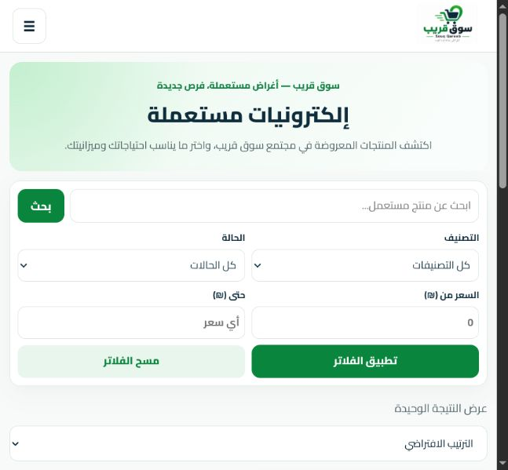
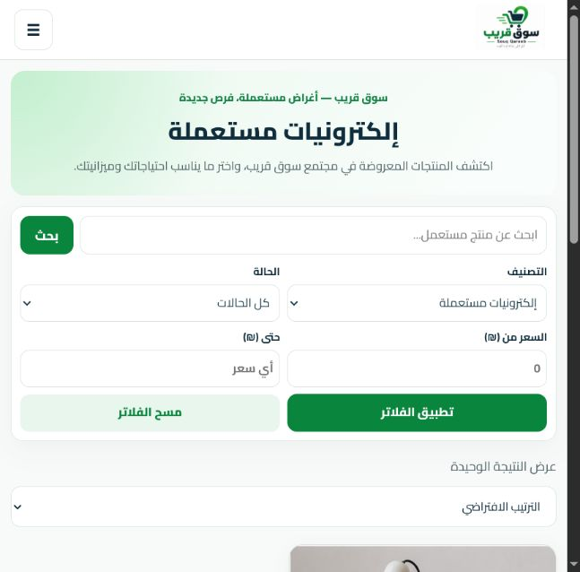
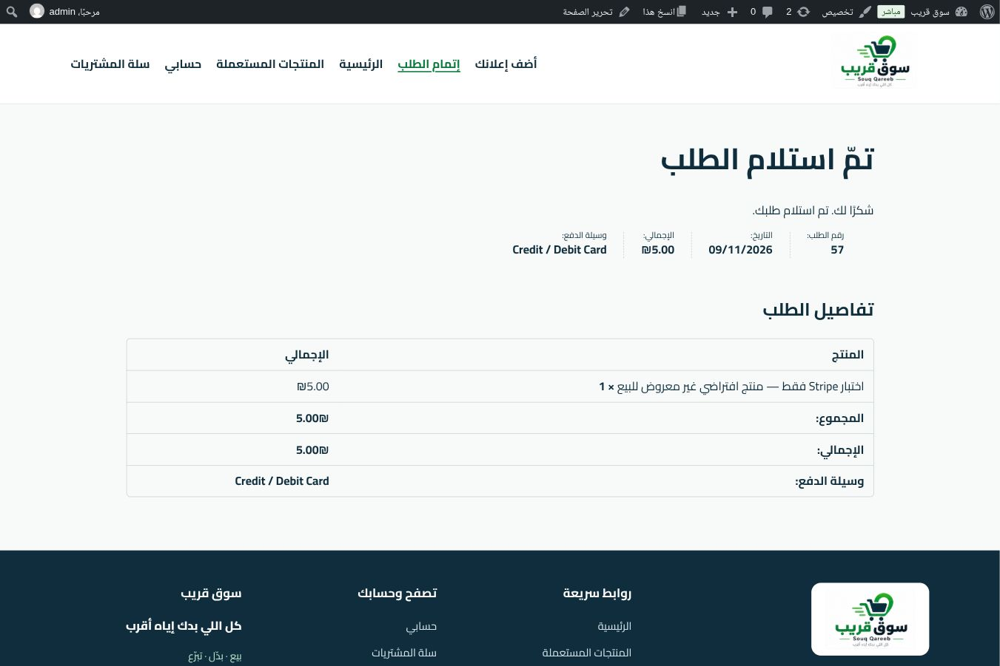
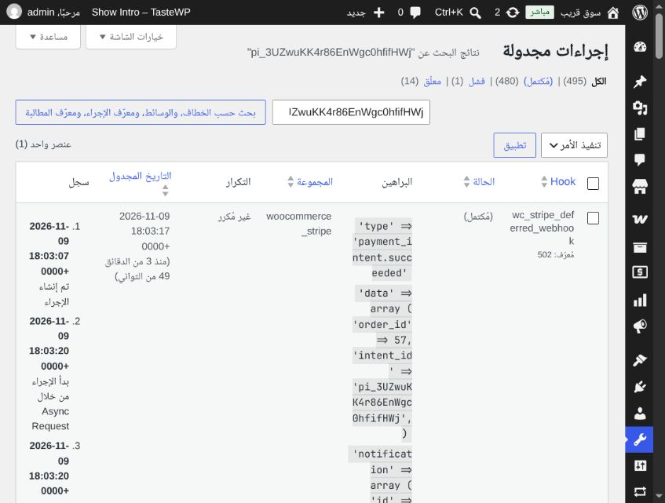
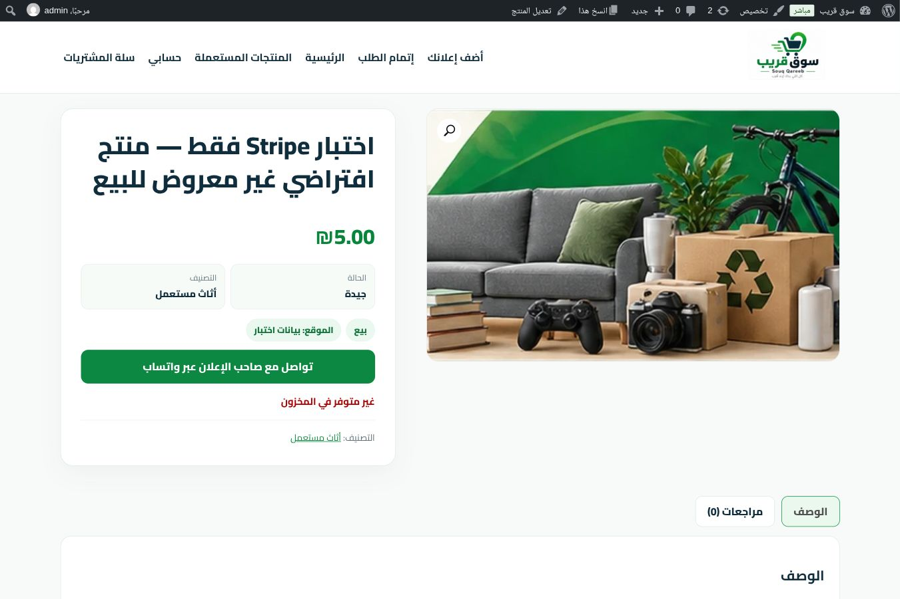
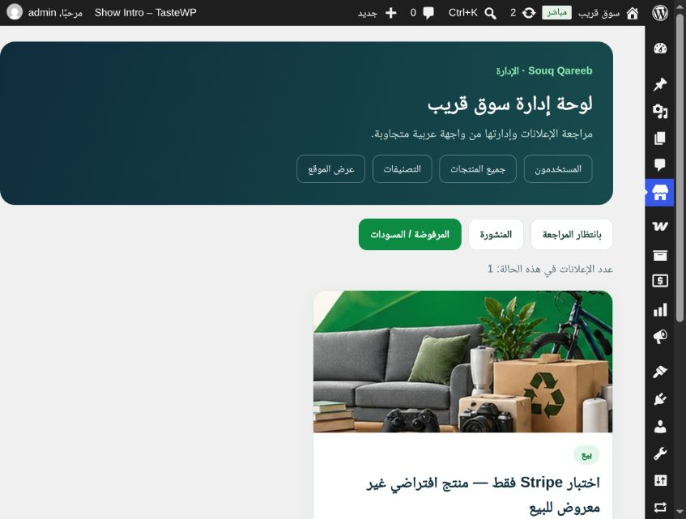

# سوق قريب — سجل المرحلة الثانية والقبول بعد النشر

**تاريخ النتائج: 9 نوفمبر 2026.** هذا هو السجل الأحدث الذي يكمل التقارير التاريخية؛ يميز بين فحوصات الكود، والنشر الذي أبلغ به المستخدم، والاختبارات المنفذة مباشرة في المتصفح. لا توجد بيئة Staging مستقلة، ولم يُنفذ دفع حقيقي أو حذف بيانات عملاء.

متابعة لاحقة: [تعريب خيار الحفظ ومراجعة Stripe Link](STRIPE_CHECKOUT_COPY_2026_11_09_AR.md). النتائج أدناه تحفظ حالة جولة القبول السابقة.

متابعة أخرى: [صور الإعلان وخط أساس HTTP وحالة البنود المتبقية](FOLLOW_UP_LISTING_PHOTOS_2026_11_09_AR.md).

## خريطة التقارير

| المرحلة | الوثيقة |
| --- | --- |
| تدقيق 8 نوفمبر وإصلاحات PR #55 | [التدقيق الأصلي](AUDIT_2026_11_08_AR.md) |
| مراجعة الكود والأمان والهاتف والصلاحيات | [تدقيق المرحلة الثانية](AUDIT_PHASE2_2026_11_09_AR.md) |
| مشكلة فقدان التصنيف وإصلاحها | [تدقيق التصنيفات](AUDIT_CATEGORY_2026_11_09_AR.md) |
| الدفع الاختباري والحدث والمخزون | [تقرير Stripe التفصيلي](STRIPE_TEST_ACCEPTANCE_2026_11_09_AR.md) |
| نتائج المتصفح وقياسات العرض | [JSON](evidence/2026-11-09/browser-results.json) |
| فحوصات الإصدار وروابط تشغيلاتها | [JSON](evidence/2026-11-09/release-checks.json) |

التقارير القديمة تحفظ ما كان معلومًا وقت كتابتها؛ عبارات «لم يُنشر» أو «لم يُختبر الدفع/المدير» فيها تصف تلك المرحلة، وقد استُكملت بالنتائج التالية.

## GitHub والإصدار والنشر

- استُخدم حساب **MohammedEmad333**. جرى دمج [PR #60](https://github.com/MohammedEmad333/souq-qareeb/pull/60) ثم [PR #61](https://github.com/MohammedEmad333/souq-qareeb/pull/61) بعد نجاح أحدث الفحوصات. لم تُكرر إصلاحات PR #55.
- إصدار main النهائي: `b85d6db171e309133a46205d11a0a2403747b65b`. دمج #60 عند `3ece81039c7d9505e18fa0f523a5cfb7a02da103`؛ و#61 عند الإصدار النهائي.
- اختُبر الفرع المجمع قبل دمج #61 عند `83588ed001b0658e6b973122ac8448c54b4b7d87`. نجحت فحوصات الإصدار التسعة المسجلة، منها تشغيل المتصفح المستقل وبيع القطعة المعزول؛ لا تُستبدل بها نتائج المتصفح الحي.
- مصدر رابط الإنتاج README: https://souq.edubridge.win. أبلغ المستخدم بنجاح نشر `b85d6db`، وإعدادات WordPress/الدفع 8/8، والصفحات 6/6، ووضع Stripe Test Mode، والنسخة الاحتياطية `theme-yngS4pqM`. هذه معلومات نشر من المستخدم؛ لم تُفحص ملفات الخادم أو النسخة الاحتياطية مباشرة. احتُفظ بالمسار الكامل في السجل الخاص خارج المستودع.
- لم يُعد النشر بعد بلاغ المستخدم. تحققنا مباشرة من السلوك الحي دون الادعاء بأن المتصفح يثبت SHA ملفات الخادم. [قائمة ملفات الإصدار وبصماتها](evidence/2026-11-09/release-manifest.json).

## المشاكل والإصلاحات

| الأولوية | المشكلة المؤكدة | الإصلاح | نتيجة الإنتاج |
| --- | --- | --- | --- |
| عالية | الموافقة تفحص تحرير المنتج دون اشتراط صلاحية النشر | #60 يضيف `publish_products` إلى المعالج والأزرار مع فحص التحرير وnonce | المدير وافق ورفض إعلان الاختبار 55 بنجاح |
| متوسطة | رابط قديم `tel:+0` وقبول تنسيقات هاتف غير صالحة | #60 يطبع الهاتف ويشترك فيه الإنشاء والتعديل والعرض، ويدعم الأرقام العربية والفارسية | اختفى رابط الرقم القديم؛ تحقق الهاتف منع الإدخال المحلي الخاطئ |
| متوسطة | تطبيق الفلاتر من أرشيف قسم يفقد التصنيف الحالي | #61 يختار تصنيف الأرشيف عند غياب اختيار صريح | بقي الإلكترونيات/الأثاث محددًا بعد التصفية |

لا يتحقق تطبيع الهاتف من ملكية الرقم أو صحة رمز دولة بعينه، ولا يغيّر أرقام المنتجات القديمة في قاعدة البيانات. إصلاح مخزون القطعة الواحدة السابق لم يُكرر؛ اختُبر على المنتج التجريبي بعد الدفع.

## الاختبارات المنفذة بعد النشر

| المسار/الوظيفة | النتيجة المباشرة |
| --- | --- |
| أرشيف الإلكترونيات | تحديد القسم الصحيح بعد إعادة التحميل؛ الفلاتر بالأسعار الفارغة أعادت المصباح الوحيد عبر تحويل WooCommerce للنتيجة الواحدة |
| الأثاث والتصنيف | بقي القسم محددًا بعد تطبيق الفلاتر مع خمس نتائج |
| بحث «كرسي» | فراغ السعر أعاد 35/45؛ الحد الأدنى 40 أعاد 45؛ الحد الأعلى صفر أعاد لا نتائج |
| تفاصيل المنتج والتواصل | رابط الرقم القديم غير الصالح غير معروض؛ لم يُتصل بأي رقم |
| السلة | منتج فردي بقيمة 35، ومنع إضافته ثانية؛ لا حقل كمية للقطعة المفردة |
| Checkout الأولي | Stripe وخصوصية عربية وإجمالي صحيح؛ لم يُرسل ذلك الطلب |
| إضافة الإعلان | رُفعت صورة WebP من أصول المشروع، ورُفض هاتف محلي، وقُبل تنسيق اصطناعي بأرقام عربية؛ إعلان 55 دخل المراجعة |
| تعديل الإعلان والسحب | حُفظ العنوان والصورة، وعاد للمراجعة ثم سُحب إلى المسودة |
| تسجيل الخروج/الدخول | خروج رسمي ناجح؛ أكمل المستخدم الدخول بأمان، دون حفظ كلمة مرور أو رمز |
| لوحة المدير | دخول رسمي بحساب admin؛ قبول الإعلان 55 ثم إعادته للمراجعة ورفضه عبر الأزرار الرسمية؛ تحقق انتقال الحالات |
| الدفع الاختباري | طلب زائر اصطناعي مستقل #57، 5 شيكل، عبر صفحة order-pay الرسمية أثناء جلسة المدير؛ Stripe نجح و`livemode=false` |
| الـWebhook | الحدث `payment_intent.succeeded` يطابق الطلب 57 وPayment Intent؛ المهمة 502 اكتملت تلقائيًا الساعة 18:03:20 UTC |
| المخزون بعد الدفع | سجل الطلب 1→0؛ تحقق المحرر من 0، والواجهة من نفاده وغياب زر الشراء؛ محاولة الإضافة المباشرة رُفضت |

اختبار المدير على الإنتاج يثبت المسار المسموح للمدير. عدم ظهور أدواته لحساب البائع لوحظ، لكن إرسال طلب مراجعة مباشر بحساب محدود على الإنتاج لم يُنفذ؛ حالات المنع والصلاحيات والرموز اختُبرت معزولة في الكود وCI.

## الصفحات والمراجعة المرئية

فُحصت في جولة المرحلة الثانية: الرئيسية، المتجر، التصنيفات الثلاثة الظاهرة، المنتجات السبعة، السلة، Checkout، الحساب وتفاصيله، إعلاناتي، إضافة وتعديل الإعلان، ثم لوحة المراجعة وصفحة الدفع وتأكيد الطلب بعد النشر.

بعد النشر، حُفظت 25 لقطة viewport للصفحات المتأثرة: الإضافة والتعديل والتصنيف وتفاصيل المنتج ولوحة المدير، كل منها عند 375/430/768/1366/1920 بارتفاع 900. لم يظهر تجاوز أفقي في قياسات المستند، واتجاهها RTL، ولا صورة محملة فاشلة. أبلغ المتصفح عن 431 و1921 بسبب التقريب. سجل JSON يتضمن قياسًا أوليًا إضافيًا للمنتج عند 375، وليس لقطة نهائية سادسة وعشرين.

القياسات لا تثبت مراجعة كل موضع من الصفحات الطويلة. بعض لقطات الجولة الأقدم الكاملة بها آثار تصوير؛ استُخدمت لقطات viewport لاحقًا. لم يُنفذ قياس أداء معياري أو تدقيق شبكة شامل. عينة Console اللاحقة تضمنت تحذير Stripe Link غير مفعّل، دون خطأ في العينة؛ لا يعني ذلك خلو الموقع كله من الأخطاء.

### قبل وبعد التصنيف على الإنتاج

قبل النشر: القائمة تعرض «كل التصنيفات» في أرشيف الإلكترونيات.

بعد النشر وإعادة التحميل: التصنيف الصحيح محدد.

### أدلة القبول الحي

## الاختبارات الآلية ومراجعة الأمان

نجحت اختبارات PHP 8.2.29 المحلية، ثم فحوصات GitHub المسجلة للإصدار: حالات الأسعار والتصنيفات الست، الهاتف (21 حالة مع العرض)، صلاحيات/nonce المراجعة (7 حالات)، المخزون (12 تحققًا)، وحارس Checkout. شملت الفحوصات صياغة PHP وJavaScript وملفات التشغيل وCompose والمتصفح والبيع المعزول. راجع التقارير الأصلية وروابط jobs في JSON للتفاصيل الدقيقة؛ لا يُعاد وصف CI بأنه اختبار إنتاج.

رُوجعت مسارات الإضافة والتعديل والسحب والمراجعة من حيث المصادقة والملكية وnonce وتعقيم المدخلات والهروب عند العرض ونوع/حجم الصور، واستخدام واجهات WordPress/WooCommerce بدل SQL نصي مباشر. لم تُجرَ محاولات استغلال على الإنتاج. لا يُعد ذلك إثباتًا لخلو جميع الإضافات أو WordPress من XSS/CSRF/SQL injection.

## الحالة النهائية والحدود

- الإعلان التجريبي 55: **مسودة مخفية، مخزونه 0**، عنوانه يوضح أنه اختبار Stripe فقط، ولا منتج للبيع. الطلب 57 محفوظ كطلب اختبار مدفوع تجريبيًا بحالة قيد التنفيذ مع ملاحظة خاصة. لم يُلغَ أو يُرد أو يُحذف، حفاظًا على الأدلة. بيانات الفاتورة اصطناعية، ولا حساب عميل موجود مرتبط به؛ لم تُعدّل بيانات العملاء الآخرين.
- مؤشر `pending 1` بقي في إعدادات Stripe؛ المهمة الخاصة بالحدث المختبَر مكتملة، والقيمة 1 موجودة في الحمولة الواردة. تفسير القيمة المحفوظة وحدوده في تقرير Stripe؛ لم يُرصد HTTP التسليم مباشرة من Dashboard أو تُفحص جميع وجهاته.
- ما زال نص حفظ بيانات الدفع بالإنجليزية وتحذير Stripe Link غير مفعّل. لم تُغير إعدادات الدفع لمعالجتهما، ولم يُنشر كود إضافي.
- غير مختبر: 3-D Secure والبطاقات المرفوضة والاسترداد وإعادة إرسال الحدث عمدًا وانقطاع الشبكة؛ إنشاء حساب حقيقي ورسائل التسجيل/استعادة المرور؛ جميع الأدوار الفعلية؛ مراجعة يدوية لكل جزء من كل صفحة، والأداء وإضافات الإنتاج بالكامل.
- تحديث كمية منتج متعدد المخزون اختُبر محليًا فقط (2→3، إجمالي 70→105)، لا على مخزون عميل في الإنتاج. تعديل صور الإعلان القائم غير مدعوم في الواجهة الحالية.
- نجاح Stripe هنا يخص معاملة اختبار واحدة عبر order-pay؛ لا يثبت جاهزية Live، ولا يكرر دورة إنشاء الطلب كاملة عبر Checkout. لا خطوة إطلاق أو تفعيل Live أو نشر كود جديد ضمن هذا التوثيق.

## حفظ الأدلة

جميع الملفات المرفوعة تحت `docs/evidence/2026-11-09/` منقحة. الصور المختارة تثبت النتائج دون صور Checkout الخاصة أو حقول العملاء أو IP أو مفاتيح الطلب أو مفاتيح Stripe أو حمولة الحدث الخام. بقيت الأدلة الإدارية الخاصة محليًا ولم تُرفع. [بصمات ملفات الأدلة](evidence/2026-11-09/SHA256SUMS) للتحقق من سلامتها. بيانات القياس تسجل ما نُفذ، ولا تفترض وجود كل اللقطات المحلية في المستودع.
