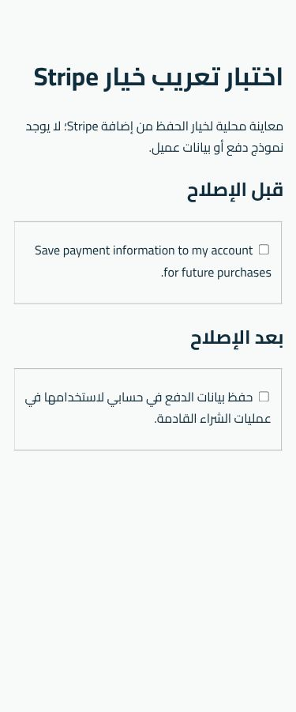
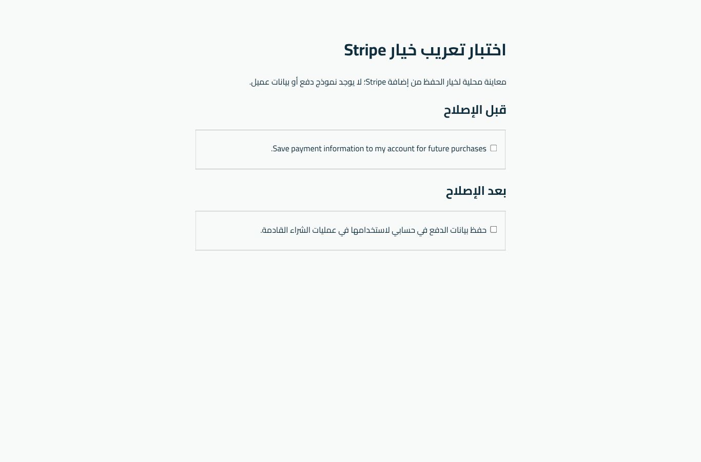

# تعريب خيار حفظ بيانات الدفع ومراجعة Stripe Link

## النتيجة والنطاق

بدأ العمل من `main` عند `e318621` بعد دمج توثيق #62. أفاد المستخدم بأنه حدّث النشر؛ لم يُفحص SHA ملفات الخادم ولم يُنفذ نشر جديد في هذه الجولة.

الإصلاح المقترح يعرض «حفظ بيانات الدفع في حسابي لاستخدامها في عمليات الشراء القادمة.» عبر فلتر الإضافة الرسمي `wc_stripe_save_to_account_text` للغة `ar` ومتغيراتها فقط. تبقى اللغات الأخرى ونصوصها المخصصة كما هي. الإضافة تملك عرض الخانة وربط التسمية بها والحالة الافتراضية وموافقة الحفظ؛ لم تُعدّل معاملات الدفع أو الوسائل المحفوظة أو Stripe.js.

## ما شوهد على الإنتاج

- إضافة WooCommerce Stripe Gateway بالإصدار **11.1.1** وWooCommerce **11.2.1**؛ Test Mode نشط.
- النص الإنجليزي موجود في HTML الأولي لصفحة Checkout الحالية. بعد اكتمال Stripe Link غابت خانة الحفظ من لقطة شجرة إمكانية الوصول النهائية. يعالج التعديل النص عندما تعرضه الإضافة، ولا يفرض إظهار خانة تخفيها الإضافة.
- إعداد **Link by Stripe** محدد في WooCommerce، بينما سجل Console من Stripe.js يبلغ بأن `link` غير مفعّل وأن سلوكه في Test Mode يختلف عن Live.
- الاستنتاج: WooCommerce يطلب Link، وحساب Stripe يبلّغ عن عدم تفعيله. لم تُفحص لوحة Stripe Dashboard مباشرة، ولا يُنسب التحذير إلى القالب أو التعريب، ولا يُدّعى إصلاحه بتعديل نصوص الواجهة.
- أُضيف عنصر إلى سلة جلسة المدير لمعاينة Checkout فقط ثم أُزيل لإعادة السلة الفارغة. لم يُرسل طلب، ولم تُكتب بيانات بطاقة أو تُحفظ وسيلة دفع، ولم تتغير إعدادات الدفع أو بيانات العملاء.

[ملخص مراجعة Link المنقح](evidence/2026-11-09/stripe-copy/link-review.json).

## معالجة إعداد Link المتبقية

المعالجة الرسمية تقع في إعدادات طريقة الدفع، خارج كود التعريب:

1. إذا كان Link غير مطلوب حاليًا، يُلغى تحديده من WooCommerce > Settings > Payments > Stripe > Payment Methods > Express checkouts ثم تُحفظ الإعدادات؛ تبقى البطاقات مفعّلة وTest Mode نشطًا.
2. إذا كان مطلوبًا، تُراجع أهلية الحساب ووضع الاختبار وإعداد `WooCommerce Inc. configuration` في لوحة Stripe، وتُطابق حالة Link بين الجانبين. تفعيل ميزة أو قبول شروط جديدة يتم عبر المالك عند الحاجة.
3. بعد الاختيار والحفظ تُعاد معاينة Checkout والسلة وسجل Console في جلسة جديدة. لا يكفي اختفاء التحذير أو نجاح CI لإثبات جاهزية الدفع الحي.

لم تُنفذ أي من تغييرات الإعدادات أعلاه في هذه الجولة. لا يُخفى التحذير برمجيًا ولا تُعطل وسائل الدفع بفلتر عام. حسب الوثائق الرسمية، قد يخفي Link خانة الحفظ الخاصة بالمتجر لأنه يتولى موافقة الحفظ داخل نموذج الدفع.

## الاختبارات

- نجح اختبار تسجيل الفلتر وثمانية متغيرات لغة: `ar`, `ar_PS`, `ar_EG`, `ar_SA`, `en_US`, `fr_FR`, `fa_IR`, `arc`.
- نجحت محليًا صياغة ملفات PHP الجديدة واختبارات حارس الدفع والفلاتر والهاتف والصلاحيات والمخزون القائمة، وفحص JavaScript و`git diff --check`.
- بُني WordPress وWooCommerce وStripe 11.1.1 في بيئة محلية مؤقتة مستقلة بقاعدة فارغة. استُخدم **renderer الأصلي للإضافة** وفلتر WordPress الحقيقي لإنتاج معاينة قبل/بعد، دون إعداد مفاتيح أو نموذج دفع أو Stripe.js.
- في Cloud Browser نجح التعرف على الخانة باسمها العربي، واختيارها وإلغاء الاختيار، وبقيت غير محددة افتراضيًا. لا يمثل اختيار الخانة في هذه المعاينة حفظ بطاقة؛ لا توجد حقول دفع أو عملية إرسال.
- فُحصت 375/430/768/1366/1920 بارتفاع 900، مع RTL ودون تجاوز أفقي. قياسا 430 و1920 أعادا 431 و1921 بسبب تقريب المتصفح. هذه مراجعة خانة الإضافة في معاينة معزولة، وليست إعادة اختبار Checkout الكامل بعد نشر الكود.
- أضيف اختبار اللغة إلى CI، وامتد اختبار المتصفح المؤقت ليولّد المعاينة من إضافة Stripe 11.1.1 الأصلية ويتحقق من التسمية والاختيار والمقاسات الخمسة ويحفظ الصور. تُراجع نتيجة التشغيل الفعلية في PR؛ لا يُحسب الاختبار ناجحًا قبل اكتماله.

[قياسات المتصفح المحلية](evidence/2026-11-09/stripe-copy/local-browser-results.json).

اللقطات الأخرى محفوظة في مجلد الأدلة نفسه. لا تتضمن حقول عميل أو مفاتيح أو معلومات دفع.

## الحدود والخطوة اللاحقة

هذا PR يبدأ بالمشكلتين المحددتين: إصلاح النص ومراجعة تحذير Link بالأدلة. تبقى اختبارات 3DS والرفض والاسترداد وإعادة إرسال Webhooks والأداء وبقية حدود التقرير السابق دون تنفيذ جديد. لا يتضمن هذا العمل دمجًا أو نشرًا جديدًا أو تغيير إعداد Link. بعد اعتماد الكود ونشره يلزم التحقق من النص على Checkout وorder-pay وتحديثه عبر AJAX؛ لم يُنشأ طلب إنتاج لاختبار order-pay في هذه الجولة.

## المصادر الرسمية

- [فلتر النص في Stripe 11.1.1](https://github.com/woocommerce/woocommerce-gateway-stripe/blob/11.1.1/includes/abstracts/abstract-wc-stripe-payment-gateway.php).
- [إعدادات Stripe ومزامنة طرق الدفع وخيار الحفظ](https://woocommerce.com/document/stripe/setup-and-configuration/settings-guide/).
- [تفعيل طرق الدفع السريع ومتطلبات Link](https://woocommerce.com/document/stripe/setup-and-configuration/express-checkouts/).
